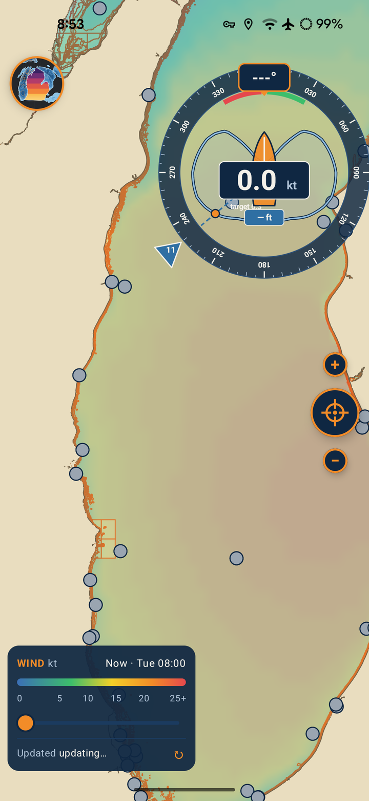
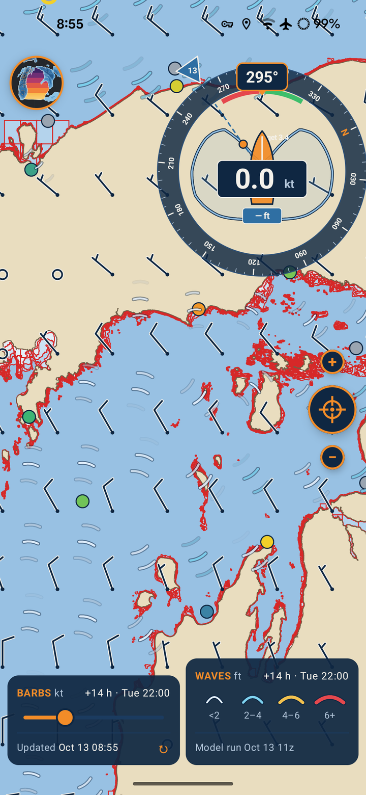
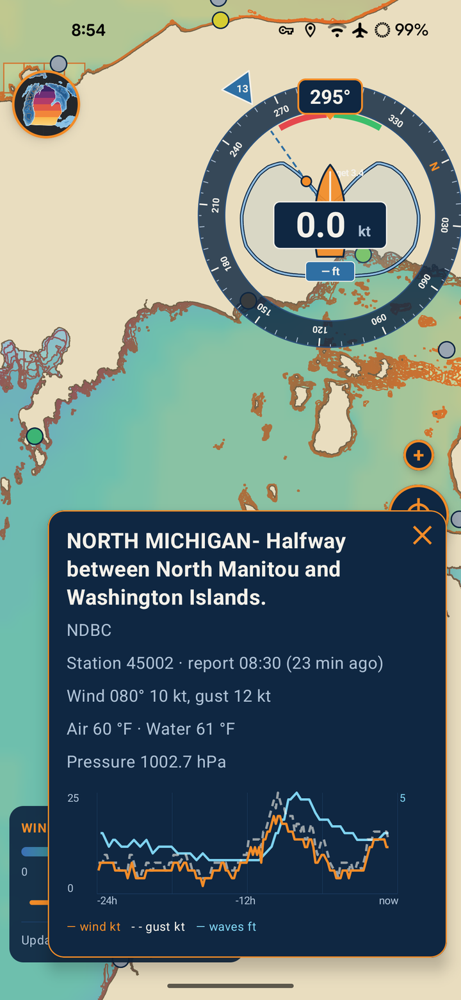
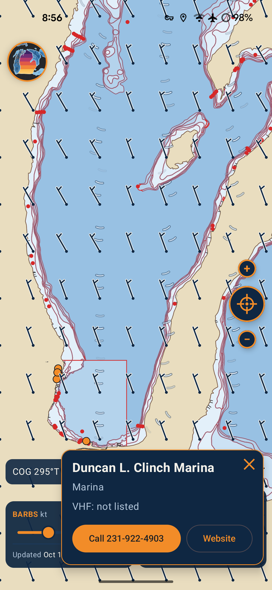

# Third Coast Sailing

Offline Great Lakes chart viewer, weather and sail-routing app for Android.

> **Not for navigation.** Official NOAA charts and notices govern. Use at your own risk.

  
  
  
  

## What it does

- **Charts:** NOAA electronic charts for Superior, Michigan, Huron, Erie and Ontario (plus connected inland lakes), stored on the phone and usable with no signal. Depth shading, hazards, and water shallower than your depth limit outlined in red.
- **Weather:** wind, gusts and waves from NOAA (NDFD and the GLWU wave model), downloaded by the phone directly — no server in between. Colour field, wind barbs, animated wave crests and a 48-hour forecast slider.
- **Buoys:** NOAA NDBC stations coloured by wind speed, ringed for waves over 3 ft / 5 ft; tap for the latest report and a 24-hour graph.
- **Boat:** GPS position, course line with 1/2/3-hour marks, and a heading-up wind gauge with your polar.
- **Routes:** lay in points, see leg distance and magnetic bearing, distance / VMG / time to destination, and calculate a weather-optimised route (isochrones, your polar at a cruise factor, tack penalty, depth limit).
- **Private by design:** no Google Play Services, no accounts, no tracking. Runs on GrapheneOS and LineageOS.

## Getting the app

**[Download the latest version](../../releases/latest)** — open the `.apk` file on your phone (Android 14 or newer). On first launch, pick your lakes; the charts download inside the app from the [charts release](../../releases/tag/charts).

## Building the app from source

1. Install Android Studio.
2. Open the `app/` folder.
3. Connect a phone with USB debugging on and press **Run**.

Requirements: Android 14 (API 34) or newer. The build fails on purpose if any Google Play Services or Firebase library is added.

## Data sources and credits

| Data | Source | Terms |
|---|---|---|
| Charts (ENC) | NOAA Office of Coast Survey | US Government work, public domain |
| Lake bathymetry | NOAA NCEI | Public domain |
| Wind forecasts | NOAA National Weather Service (NDFD) | Public domain |
| Wave forecasts | NOAA NCEP (GLWU) | Public domain |
| Buoy observations | NOAA National Data Buoy Center | Public domain |
| Marinas, clubs, docks, anchorages | © OpenStreetMap contributors | [ODbL 1.0](https://opendatacommons.org/licenses/odbl/) |

Harbour data derived from OpenStreetMap is available under the ODbL.

## License

The app is licensed under the **GNU Affero General Public License v3.0** — see [LICENSE](LICENSE).
