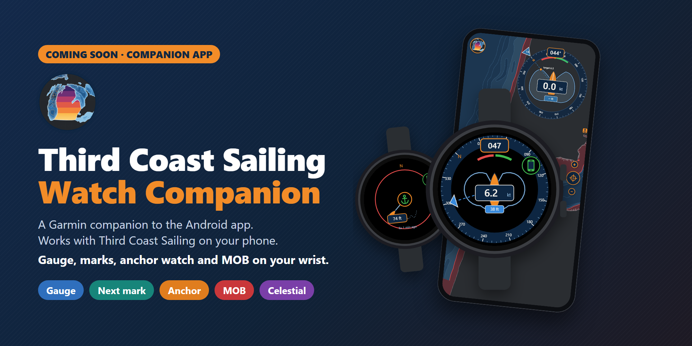

# ⌚ Third Coast Sailing Watch Companion (for Garmin)



**Status: in development, not released yet.** It will be published on the Garmin Connect IQ Store once testing is
done. This folder is a separate project from the Android app in `app/`; it shares the repository, not the build.

A **companion app**, not a standalone one: it needs the Third Coast Sailing Android app on your phone, which supplies the
charts, forecasts, route and anchor watch. The watch shows them on your wrist and sends commands back:

| Page | What it shows |
|---|---|
| **Gauge** | Wind gauge with the polar, target speed, SOG and depth, heading-up compass ring |
| **Next mark** | Bearing, distance and time to the next route point; the whole route as a ring; VMC and SOG; haptics at quarters, approach and arrival |
| **Anchor watch** | The boat swinging live around the anchor inside the red alarm ring, distance to the anchor. The boat's colour shows the phone's fix (green good, yellow stale, blinking red lost). Tap the anchor for settings, hold it to lift |
| **Set anchor** | Aim the bearing with the watch compass (or dial it), distance and alarm-radius dials, set or lift the anchor from the watch |
| **Sight** (celestial training) | Mark sight times to the millisecond, enter sextant angles, review the trend for up to 3 bodies |
| **MOB** | One tap marks a man overboard; time in the water, bearing and distance, with an arrow to the person |

A phone icon on every page shows the link: green connected, yellow slow, orange pairing, red offline. Tap it for
the link screen.

Battery: nothing runs when the app is closed (no background service). Left open and untouched for 10 minutes with no
anchor watch, MOB or route running, it pauses (GPS and phone link off); after 30 minutes it closes itself.
Details in [docs/BATTERY_REVIEW_2026-11-24.md](docs/BATTERY_REVIEW_2026-11-24.md).

## How it talks to the phone
The watch app talks to Third Coast Sailing on the phone through the phone app the watch already uses:
- **Gadgetbridge** (open source): watch → phone by a web request to TCS on the phone itself, phone → watch by
  Gadgetbridge's watch-app message intent. Needs three one-time Gadgetbridge settings, listed in
  [docs/GADGETBRIDGE.md](docs/GADGETBRIDGE.md).
- **Garmin Connect:** planned, still being tested.

Pairing shows a 4-digit code on the watch that you allow in TCS. After that, every connection proves itself with an
HMAC-SHA256 challenge; the pairing token never travels again. The messages are in
[docs/PROTOCOL.md](docs/PROTOCOL.md) (section 9 is the current transport).

## Watches
Connect IQ 3.2 and newer, round colour screens: 107 Garmin watches, including fēnix, epix, Forerunner, vívoactive, Venu,
Enduro, MARQ and Descent. Rectangular watches (Venu Sq), Edge and GPSMAP units and the monochrome Instinct are not built
for now: the layout looked cluttered or used too little of their screens. Details per device are in
[docs/COMPATIBILITY.md](docs/COMPATIBILITY.md).

## Building
Needs the Connect IQ SDK (Monkey C) and your own Connect IQ developer key.
```
export CIQ_KEY=/path/to/your/developer_key.der
bash scripts/build.sh vivoactive5            # one device -> bin/TCS-vivoactive5.prg
bash scripts/build_all.sh                    # every supported device (release builds)
bash scripts/sim.sh --tour vivoactive5       # simulator demo tour with screenshots
node --test reference/logic.test.js reference/wire.test.js   # navigation maths and wire format tests
```
`tools/gen_build.js` regenerates `manifest.xml` and the jungle files from the SDK's device list.

| Folder | What |
|---|---|
| `source/` | Monkey C source; `source-color/` and `source-mono/` hold the colour and monochrome themes |
| `reference/` | The maths and the wire format in JavaScript, with tests; the watch code is a line-for-line port |
| `docs/` | Design, protocol, device compatibility, Gadgetbridge setup |

## Licence
Same as the rest of this repository: AGPL-3.0. Not for navigation: official charts and notices govern.
